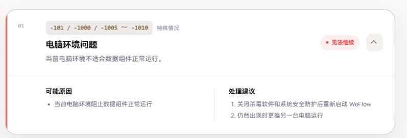

+++
title = "WeFlow 报错修复教程：-101 到期检查与 -105 状态不一致"
date = 2026-10-08
lastmod = 2026-10-11
description = "记录 WeFlow 6.3.1 的 -101 到期修复与后续 -105 排查，提供 DLL 替换方法和无需 Codex 的状态同步脚本，并说明适用范围、备份与验证步骤。"
tags = ["WeFlow", "Windows", "故障排查", "DLL"]

[[resources]]
name = "feature"
src = "weflow.jpg"
+++

2026 年 10 月，我先遇到了 WeFlow 的 `-101`，修复组件期限后，又在正常退出、重新打开时遇到 `-105`。后来查到，`-101` 是 DLL 到期，后面的 `-105` 则是本机三份状态记录没有同步。

遇到 `-101`，可以先按第一节替换 DLL；替换后如果出现 `-105`，再按第二节检查是否为状态副本不一致。

## 1. 快速修复 -101：下载 DLL 后替换

### 适用范围与下载

测试条件为 **Windows11 x64、WeFlow 6.3.1**，覆盖DLL文件时应先对原文件进行备份。

[下载修复版 wcdb_api.dll](wcdb_api.dll)（约 1.58 MiB）。

修复版 SHA-256：

```text
0193625007c14fd7f95e882750e78fb9e47267a5a743dbaf95601aa373a23992
```
补丁将六处期限延至北京时间 **2037 年 10 月 1 日 00:00:00**。

### 替换步骤

1. 通过托盘菜单完全退出 WeFlow，在任务管理器中确认后台没有 WeFlow 进程。
2. 打开安装目录中的 `resources\resources\wcdb\win32\x64\`。默认完整路径为：

   ```text
   C:\Program Files\WeFlow\resources\resources\wcdb\win32\x64\
   ```
3. 将原文件重命名为 `wcdb_api.dll.bak`，保留备份。如果已有同名备份，先核对内容，另存一份，不要直接覆盖。
4. 下载修复版DLL，将它以 `wcdb_api.dll` 的文件名放入同一目录，按 Windows 提示授予管理员权限。
5. 正常打开 WeFlow，再通过托盘退出并重新打开一次。若未出现报错，说明启动和重启检查通过，无需执行下一节针对 -105 错误的修复。

需要撤回 DLL 补丁时，完全退出 WeFlow，把修复版DLL删除，再将原始备份恢复为 `wcdb_api.dll`，恢复原件也会恢复原有期限。

## 2. 替换后出现 -105：先判断是否为状态副本不一致

### 这次 -105 的原因

本机出现的提示是：

> 离线防回拨状态损坏或无法安全保存，请检查当前用户目录权限（错误码：-105）

虽然提示要求检查目录权限，但 `-105` 也可能出现在防回拨状态的加载、校验或保存过程中，还需要查看具体记录。

Weflow一共维护了三份数据记录：

- `%LOCALAPPDATA%\WeFlow\State\native-anchor-v7-*.bin`
- `%LOCALAPPDATA%\WeFlow\Runtime\anchor-v7-*.bin`
- 用户注册表 `Software\WeFlow\Runtime` 中对应的 `AnchorV7-*` 条目

经确认，出现 -105 报错时，三份记录都能读取、解密并通过组件校验，但两份文件中的时间和计数已经更新，WeFlow 读取到的注册表记录仍较旧，因此报错 -105 一致性检查失败。

这里我一度判断错了：外部检查显示三份记录一致，但 WeFlow 实际读到的注册表值仍是旧的。最后用 WeFlow 已持有的用户注册表根句柄查询，才找到了这份旧记录。

### -105 报错解决方案

[下载状态同步脚本 weflow_state_sync.py](weflow_state_sync.py)。

该脚本使用 Python 标准库，它会通过正在运行的 WeFlow 查询实际注册表视图，而不是直接使用脚本自己看到的 `HKCU`。

**只适用于第一节指定的修复版 DLL，且在替换DLL后出现 -105 的情况。** 默认只检查，只有显式加上 `--apply` 才会备份后执行注册表同步。

1. 从 [Python 下载页](https://www.python.org/downloads/windows/) 安装 **64 位 Python**。脚本已在 Python 3.12 x64 上验证。
2. 把脚本保存到独立的本机目录（无中文和空格），例如 `C:\WeFlow-repair`，文件名为 `weflow_state_sync.py`。
3. 正常打开 WeFlow，**保留 -105 报错窗口和后台进程**。这一步需要 WeFlow 的运行中句柄，因此先不要退出。
4. 打开 PowerShell，进入保存脚本的目录，执行注册表检查：

   ```powershell
   Set-Location -LiteralPath 'C:\WeFlow-repair'
   py -3 .\weflow_state_sync.py --check
   ```
5. 只有输出显示 **“注册表副本较旧，可备份后同步”**，且 WeFlow 状态尚未加载成功时，才执行：

   ```powershell
   py -3 .\weflow_state_sync.py --apply
   ```
6. 脚本会把两份文件和原注册表加密值备份到脚本旁的 `weflow-state-backups` 目录，再同步对应条目，并读回核对。完成后，通过托盘完全退出 WeFlow，再重新打开；正常后再退出、重开一次。

脚本不会加载或调用 DLL 自检，不会读取设备根密钥，也不会修改 DLL、系统时间、账号配置或微信数据库。它检查 DPAPI 解密、记录格式、设备/构建匹配及时间和计数不倒退。脚本没有实现 DLL 内部完整的一致性校验，因此同步完成后，还要启动 WeFlow，确认报错是否消失。

如果输出“两份文件不一致”“设备/构建不匹配”“DPAPI 解密失败”“DLL 哈希不匹配”，或“实际三份副本一致”，就不属于本脚本可以直接处理的情况。

我测试了脚本的备份功能，以及阻止时间和计数倒退、检测同步期间状态变化的保护逻辑。本机的 `-105` 已通过脚本解决，但还没在其他故障电脑上验证。

下面记录这两次报错的排查过程，包括 DLL 的修改位置和测试结果。

## 3. 故障现象：10 月之后突然报 -101

2026 年 10 月 1 日之后，WeFlow 出现了 `-101`。我使用的版本为 WeFlow 6.3.1，故障截图如下：



参考 [hicccc77/WeFlow#1222](https://github.com/hicccc77/WeFlow/issues/1222) ，定位到了安装目录中的 `wcdb_api.dll`：这份原生组件带有日期检查，截止时间为北京时间 **2026 年 10 月 1 日 00:00:00**。

## 4. 原因排查：DLL 里不止一处日期检查

[issue#1222](https://github.com/hicccc77/WeFlow/issues/1222) 中分析的是 Windows x64 下 WeFlow 5.0.0 的另一份 DLL：最初报 `-101`，仅处理第一处到期后又遇到 `-1000`，且issue中并未提供修复后的 DLL 文件。

继续检查后，在这份 DLL 中找到了六处日期检查。逐一测试时间边界，最后能够通过的时刻均为 Unix 时间 `1790783999`，即北京时间 **2026 年 9 月 30 日 23:59:59**；与故障日期吻合。

## 5. DLL 修改：把六处期限一起延后

将六处截止时间从 `1790784000` 改为 `2137939200`，即北京时间 **2037 年 10 月 1 日 00:00:00**。新值仍小于 `0x80000000`，没有超出有符号 32 位整数的正数范围。

补丁在六处加载常量的位置插入跳转，转到原有代码节末尾的空白区域：先执行原来的常量加载，仅遇到旧期限时才换成新期限，然后执行原来的后续指令，最后返回原位置。

原来的日期比较仍保留，只改变截止时间。补丁也保存和恢复标志寄存器，使其他值继续按原路径处理。六处修改位置如下；RVA 是相对虚拟地址，与磁盘文件偏移不同：

| 常量加载入口 RVA | 文件偏移 | 新增代码 RVA |
| --- | --- | --- |
| 0x11ea59 | 0x11de59 | 0x149120 |
| 0x122b8a | 0x121f8a | 0x149140 |
| 0x126b1c | 0x125f1c | 0x149160 |
| 0x1294f7 | 0x1288f7 | 0x149180 |
| 0x12e7aa | 0x12dbaa | 0x1491a0 |
| 0x13597a | 0x134d7a | 0x1491c0 |

DLL 还有完整性检查。因此代码修改后，按组件原有方式重新计算参与校验的节头字段和节内容，更新 RVA `0x1897d0` 的内部摘要。这是组件自身的完整性摘要，不是厂商数字签名。

修复版与原版共有 **237 个字节不同**。新增代码利用了已有填充空间，只扩展对应可执行节的虚拟大小；文件长度仍为 1,651,712 字节，`SizeOfImage`、导出名称和导出地址均保持不变。

这些地址只对应本文指定版本，不保证其他版本可用。

## 6. 修复后测试与方法纠正

重新核对了安装目录中的 DLL 和两份原件备份。此前对组件做诊断时，原版返回 `-101`，修复版返回了 WeFlow 要求的版本值：

```text
POLICY 1464206081
DIAG 0x111c70 1
DIAG 0x1124b0 1
DIAG 0x1135e0 1
CONTEXT 0 1
```

六个日期函数的最后通过时刻均变为 `2137939199`，即北京时间 **2037 年 9 月 30 日 23:59:59**。

后续 `-105` 修复完成后，临时诊断 DLL 已全部移除，安装文件恢复为第一节的到期修复补丁。正常打开、托盘退出再打开均正常，实际两份文件和 WeFlow 注册表视图中的摘要一致。

这次排查中，我发现自己之前忽略了一点：DLL 的版本自检会更新防回拨状态。从不同注册表视图运行自检，可能让文件和 WeFlow 读到的注册表记录不一致。因此，后面的验证也包括托盘退出后重新打开。

本机已通过期限检查和组件校验，两次启动、托盘退出后重开也都正常。其他功能还没有逐项测试。
